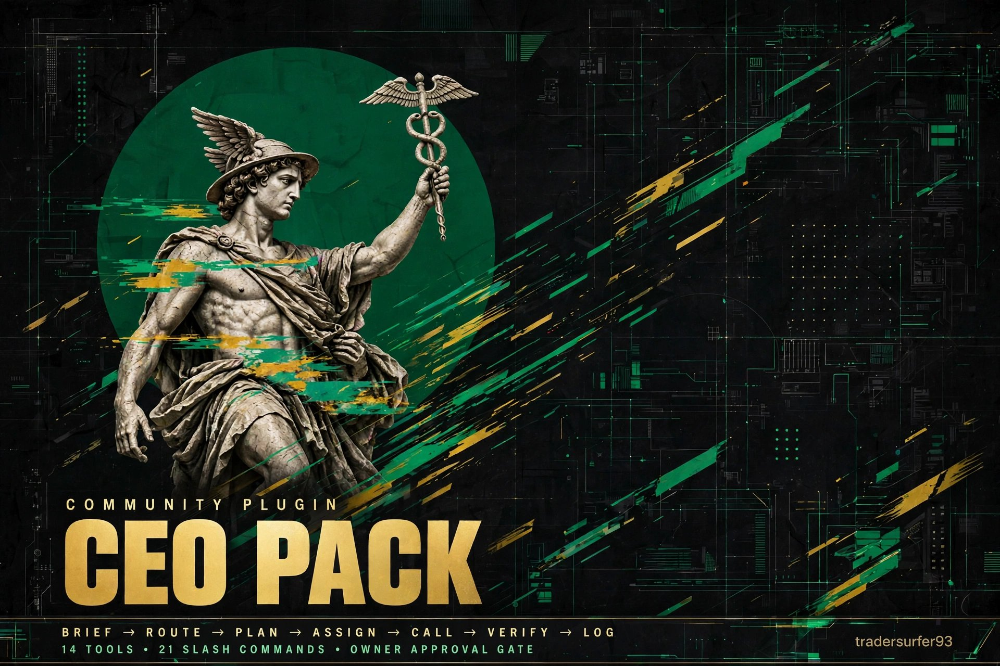
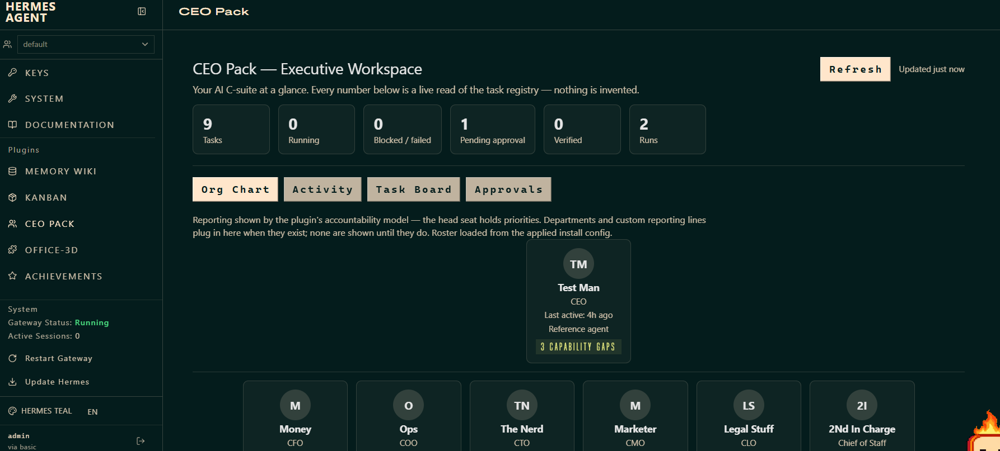
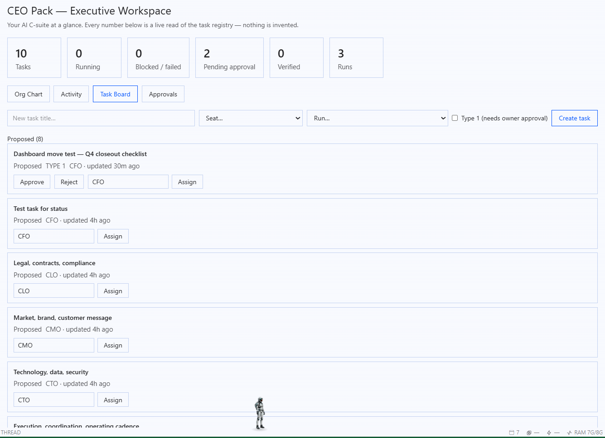

# CEO Pack

Your AI C-suite inside Hermes. Say what your business needs in plain words — the pack turns it into a plan, gives each job to the right seat, checks the work before calling it done, and stops for your approval before anything big, priced, or hard to undo.

> Created by **tradersurfer93**. Community plugin for [Hermes Agent](https://github.com/NousResearch/hermes-agent) by [Nous Research](https://nousresearch.com). MIT licensed.

<p align="center">
  
</p>

<p align="center">
  <strong>v0.5.0 · Hermes 0.22.5+ · Dashboard tab + Desktop page · 21 tools · 29 slash commands</strong>
</p>

<p align="center">
  <a href="./CHANGELOG.md"></a>
  <a href="./LICENSE"></a>
  <a href="https://github.com/NousResearch/hermes-agent"></a>
  <a href="https://github.com/tradersurfer/ceo-pack"></a>
</p>

## What it is

CEO Pack is not a chat wrapper. It is an orchestration layer for Hermes: you talk like a business owner, and it briefs, routes, plans, assigns, calls tools one at a time, verifies, and logs decisions — with Hermes as COO and you as the boss.

- **Session mode** — say `/ceo` once and CEO mode stays on for the whole chat. It reads your words, works out the goal, says it back in one plain sentence, then runs the flow on every business message until you say `/ceo off`. You never type `/ceo` on every message.
- **Every answer is ELI5** — plain words a busy entrepreneur or business owner can follow. No jargon, short sentences, one idea at a time, and always what happens next.
- **The dashboard tab** — click the CEO Pack tab (`/ceo-pack`, after Kanban) and watch the C-suite work: the org chart, a live activity feed, the task board, and the approval center. Seats active in the last 2 minutes pulse green with a LIVE label. Create, approve, reject, and assign from the UI — the same registry the chat tools use.
- **The Desktop page** — a native Desktop plugin (sidebar row + `/ceo-pack` page over `ctx.rest`). No iframe, no login wall. Same numbers, same writes, same live pulse.
- **A persistent task registry** — every task and run lives in a local SQLite registry with UUID ids, an enforced lifecycle (proposed → approved → assigned → running → blocked/completed → verified), dependencies, and execution history. Unknown is shown as unknown — never a zero or an invented timestamp.
- **Delegation you can configure from chat** — each seat runs on a model route or a Hermes profile route (`/ceo delegation`). The plugin never creates agents.
- **Type 1 stops, Type 2 goes** — anything external, priced, irreversible, legal or financial, security, people, regulatory, reputation, or outside your authority stops and asks you first. Reversible, low-cost, bounded work proceeds.
- **Credential-safe** — tool-call envelopes are validated before dispatch: exact tool name, JSON arguments, no credential keys or values (nested included). Unknown tools and credential content are refused, and secret values are never echoed — only their path is named.
- **The seats are roles, not people** — you do not need seven agents. A seat is a job title. If you made a real Hermes profile for a seat, the work goes there. If you did not, the same main agent does the work wearing that seat's hat — it thinks like a CFO for a money job and like a CLO for a legal job. The roster shows which seats are tied to a real profile and which fall back.

The full list of changes per version lives in the [changelog](./CHANGELOG.md).

## Visual tour

<!-- Screenshots live in assets/readme/ — drop real shots from the Dashboard tab and the Desktop page there (see "Screenshots" in docs/CATALOG_PR_v050.md). -->

| Org chart — live seats | Task board — approve, assign, create |
| --- | --- |
|  |  |

## Requirements

- Hermes Agent 0.22.5 or later (tested on 0.23.1). The dashboard tab needs the web Dashboard; the Desktop page needs the Hermes Desktop app.
- No extra services, no API keys, no paid models. The plugin is stdlib-only — it never calls a model itself and never touches the network. Your Hermes model does the work; the plugin recommends a pick per job.

## Quick start

### 1. Install

From the catalog (stable — serves v0.4.1 until v0.5.0 merges):

```bash
hermes plugins install ceo-pack --enable
```

For v0.5.0 right now, install the branch:

```bash
hermes plugins install https://github.com/tradersurfer/ceo-pack.git#v0.5.0-dev --enable
hermes gateway restart
```

### 2. Turn CEO mode on

In any chat with the default profile (plugins are per-profile — ceo-pack lives in the default profile, not in a named one unless you install it there):

```
/ceo
```

The reply is short: `CEO ON. Use '/ceo off' to turn it off.` Then ask in plain words:

```
how do I set up my business with you?
```

The pack says the goal back in one plain sentence, briefs it, routes each workstream to a seat, assigns one owner and one due date per job, and logs the decision. Or do it in one go: `/ceo how do I set up my business with you?`

### 3. Watch it work

Open the **CEO Pack** tab in the Dashboard (after Kanban) or the Desktop sidebar. The org chart lights up as seats work, the task board shows each job move, and anything Type 1 waits in the approval center until you approve it.

### 4. Turn it off

```
/ceo off
```

## The flow

**Brief → Route → Assign → Do → Verify → Log**

1. **Brief** — say the goal in one plain sentence. (`ceo_brief`)
2. **Route** — the pack picks the seat for each job: money (CFO), legal (CLO), marketing (CMO), tech (CTO), running the business day to day (COO / Hermes), or the chief of staff. (`ceo_route`)
3. **Assign** — one owner and one due date per job. (`ceo_assign`)
4. **Do the work** — the tool runs, with the risk flags on top, never buried inside. (`ceo_tool_call`)
5. **Verify** — the pack checks the work is really done before it counts. (`ceo_verify`)
6. **Log it** — the decision goes in the log. (`ceo_decision_log`)

One tool at a time, check the JSON result before the next step, retry once with corrected arguments then escalate — never retry a write, send, or payment blindly. See [`docs/ORCHESTRATION.md`](docs/ORCHESTRATION.md).

## The seats

CEO, CFO, COO (Hermes), CTO, CMO, CLO, Chief of Staff, CRO. Canonical seats never change; install config can rename a seat for display (e.g. COO to Poseidon) and bind a Hermes profile to it, with a display name, avatar, and SOUL — display-only, logs show `Alias (Canonical)`.

- **Head CEO** — `head_seat` config (default CEO) picks the seat that holds priorities and the decision log. The human owner is still the final Type 1 gate.
- **Capability check** — each seat has a checklist. `ceo_roster` lists what a bound profile is missing; the pack proposes an owner-gated install plan for the gap. Declining leaves a name-only binding, flagged in plan and log.
- **Opt-in business-data reading** — an ephemeral, chat-scoped opt-in naming exact fields, a purpose, and an expiry. Every read is audited, revoke is instant, and a fresh opt-in is required for any future read.

## The dashboard tab

Path `/ceo-pack`, position after Kanban. Four views, one registry behind them:

- **Org chart** — a generic tree from the roster (departments plug in later). Click a seat to see its assignments. A seat active in the last 2 minutes shows a pulsing green dot and a bold **● LIVE** label; seats with no recorded activity show "Last active: unknown", never an invented time.
- **Activity center** — the feed of what moved, newest first, with task history events. Rows that changed since the last poll flash once.
- **Task board** — tasks grouped by status, with a create form (title, seat, run, Type 1 checkbox), seat/status/search filters, and expandable cards. Create, approve, reject, and assign work from here — the same `tasks.py` functions the chat tools call, with the same lifecycle and permission checks. A contended write surfaces as a 503, not a silent failure.
- **Approval center** — pending Type 1 tasks with Approve / Reject, plus history. Free-form `ceo_decision_log` entries are not persisted in v0.5.0 — the UI says so plainly.

The tab polls every 30 seconds. The API contract is in [`dashboard/API_CONTRACT.md`](dashboard/API_CONTRACT.md).

## The Desktop page

`desktop/plugin.js` is a native Desktop plugin: a sidebar row and a `/ceo-pack` page over `ctx.rest`, with the same four views, the same writes, and the same live pulse. It replaces the earlier iframe embed, which showed the gateway sign-in screen instead of the pack.

Two things to know on Desktop:

- The shell syncs the unified package's desktop file into `desktop-plugins/` **at app start**, not on reload. After pulling an update, fully quit and relaunch the Desktop app — `Cmd+K → Reload desktop plugins` alone will not pick it up.
- "Last active: unknown" on every seat means the gateway is still running an older `plugin_api.py`. Restart the gateway (Dashboard → Restart Gateway, or relaunch the app) and the times appear.

## Delegation

Each seat runs on a model route or a Hermes profile route, configured with `/ceo delegation` in chat or `hermes ceo delegation` in the terminal. Modes: built-in (the main agent, wearing the seat's hat) or unified (the Advanced Delegation provider). Reconciled against the real Advanced Delegation source — see [`docs/DELEGATION_RECONCILIATION.md`](docs/DELEGATION_RECONCILIATION.md). Execution metadata (route, tokens, cost, duration, exit reason) is recorded on the task and shown in the dashboard; cost is never estimated, unknown stays unknown.

## Tools

21 tools, 29 slash commands. The chat tools:

| Group | Tools |
|---|---|
| Orchestrate | `ceo_orchestrate`, `ceo_brief`, `ceo_route`, `ceo_assign`, `ceo_tool_call`, `ceo_verify`, `ceo_decision_log`, `ceo_choose_model`, `ceo_roster` |
| Closeout & checks | `q4_closeout_checklist`, `ceo_closeout_checklist`, `ceo_daily_check`, `ceo_performance_check`, `ceo_status_check` |
| Tasks & runs (v0.5.0) | `ceo_task_create`, `ceo_task_status`, `ceo_task_list`, `ceo_task_approve`, `ceo_task_assign`, `ceo_run_create`, `ceo_run_status` |

Slash commands: `/ceo`, `/q4`, `/orchestrate`, plus `/brief`, `/assign`, `/verify`, `/log`, `/decision`, `/route`, `/models`, `/weekly-pulse`, `/closeout`, `/q1`, `/q2`, `/q3`, `/monthly-closeout`, `/daily-checks`, `/eod-checks`, `/performance-checks`, `/status-check`, `/roster`, `/task-create`, `/task-status`, `/task-list`, `/task-approve`, `/task-assign`, `/run-create`, `/run-status`, and `/ceo delegation`.

Every slash command is analyze-first: it reads your words and works out the tool's inputs before calling it, asking ONE short question when something required is missing — never a bare pointer. The `ceo-pack-usage` skill ships in the plugin with the whole flow in plain words.

## Model choice — your Hermes model runs, the plugin recommends

The agent runs on whatever model you already selected in Hermes — the plugin never switches it. `ceo_choose_model` recommends the best pick for the job from the list in [`docs/MODELS.md`](docs/MODELS.md):

| Choice | Use for |
|---|---|
| **Nemotron 3 Ultra free** (`nvidia/nemotron-3-ultra-550b-a55b:free`) | CEO default — 550B, 1M context, orchestration |
| **Nemotron 3.5 Lightning free** (`nvidia/nemotron-3.5-lightning:free`) | Fast, narrow worker jobs — never the CEO seat |
| **Ling 3.2 Flash free** (`inclusionai/ling-3.2-flash:free`) | Second free worker — 1M context, tools work |
| Claude Sonnet 5.5 | Paid value, everyday frontier |
| Claude Opus 5.5 | Paid flagship, high stakes only — override, not default |

Free caveat, up front: OpenRouter free is 20 requests/min and 50 requests/day until $10 of credits, then 1,000/day — and a CEO task is many requests, one per tool round-trip. Free lineups turn over fast, so verify the live provider list before a demo. The NVIDIA free host lists prompts as "May train" / logged — do not send client books through the free route. The plugin returns the recommendation and IDs; it does not call a model itself, so it stays stdlib-only and catalog-safe.

## Approval gate

Nothing external, priced, or shipped without owner approval for that item. A decision log entry is not approval. Tools flag approval; the owner approves in chat or from the dashboard approval center.

Known limitation, stated plainly: in v0.5.0, Type 1 approval is **flag-not-block**. A task flagged `approval_required` waits for your approval in the approval center, but `ceo_task_assign` itself does not block an unapproved Type 1 task. A blocking `pre_tool_call` gate is design-only until the owner says build it.

## Security model

CEO Pack is intentionally conservative:

- Stdlib-only. No network calls, no model calls, no file writes outside the local task registry, no secrets declared.
- Credential-safe by construction: keys and values are refused at the envelope, nested included, and secret values are never echoed — only their path is named.
- Type 1 decisions stop for the owner; Type 2 proceeds fast. External actions need owner approval.
- Business data is read only under a session-bound opt-in naming exact fields, a purpose, and an expiry — every read audited, revoke instant.
- No business data, client data, prices, locations, personal names, credentials, or logs from any private machine ship in the plugin. You configure your own business on install. See [`PRIVACY.md`](PRIVACY.md) and [`docs/SECURITY.md`](docs/SECURITY.md).

## Troubleshooting

### The CEO Pack tab is not in the Dashboard

The server's plugin list is cached — restart the gateway (Dashboard → Restart Gateway), then hard-refresh (`Ctrl+Shift+R`). If the tab still does not appear, check `/api/dashboard/plugins` lists `ceo-pack`; it needs the web Dashboard, not the Desktop app alone.

### The CEO Pack tab is missing in the Desktop app

Fully quit and relaunch the Desktop app — the shell syncs the desktop file at startup, not on reload. If the plugin page shows `duplicate id "ceo-pack"`, delete the hand-copied standalone folder (`%LOCALAPPDATA%\hermes\desktop-plugins\ceo-pack`) so the unified package copy loads, then relaunch.

### Every seat shows "Last active: unknown"

The gateway is running an older `plugin_api.py`. Restart the gateway and the times appear — the live dot only pulses once the roster carries real activity.

### `/ceo` prints a wall of text, or stalls with "Session noted"

You are on a build before v0.5.0-dev `9df6e4f`. Pull the branch and restart the gateway — `/ceo` now replies with a short state message (`CEO ON`) and the flow lives in the `ceo-pack-usage` skill.

### A tool call is refused for a credential

That is the envelope check working: the call carried a key, token, secret, or password (nested counts). Pass a reference — a file path, a record id — never the value.

### The model fell back to another free model mid-task

The free tier was busy or rate-limited (the reply names the fallback). It is a provider limit, not a plugin failure. Retry, or set a paid model with `ceo_choose_model`.

### `ceo_brief` says "No goal provided"

The goal comes from your words. Say what you are trying to achieve in one sentence, or run `/ceo` first and let the pack work the goal out before it briefs.

## Development

```bash
python -m unittest discover -s tests   # 317 tests
python demo/demo_flow.py                # demo, expect rc=0
```

```text
__init__.py          plugin registration, slash commands, /ceo session mode
orchestration.py     router, verifier, orchestration engine
tasks.py             persistent task/run registry (SQLite, WAL)
schemas.py           tool schemas
models.py            model recommendations (no model calls)
dashboard/           web Dashboard tab: manifest, API, dist/
desktop/             native Desktop plugin (plugin.js)
skills/              bundled skills incl. ceo-pack-usage
docs/                architecture, delegation reconciliation, catalog PR prep
tests/               suite (incl. dashboard, delegation, command tests)
demo/                end-to-end demo flow
```

## Relationship to Hermes Agent

[Hermes Agent](https://github.com/NousResearch/hermes-agent) is an open-source project by Nous Research. CEO Pack is a community plugin by tradersurfer93 that runs on the Hermes runtime — it adds orchestration, a dashboard tab, and a Desktop page without touching core files or adding model calls.

Useful links:

- Hermes docs: <https://hermes-agent.nousresearch.com/docs>
- Hermes upstream repo: <https://github.com/NousResearch/hermes-agent>
- CEO Pack catalog entry: `plugin-catalog/ceo-pack.yaml` in the Hermes repo (see [`docs/CATALOG_PR_v050.md`](docs/CATALOG_PR_v050.md) for the v0.5.0 bump)

## Author

Built by **tradersurfer93**. If this pack runs your business, a star on the repo is the thank-you.

## License

MIT. See [`LICENSE`](LICENSE).
